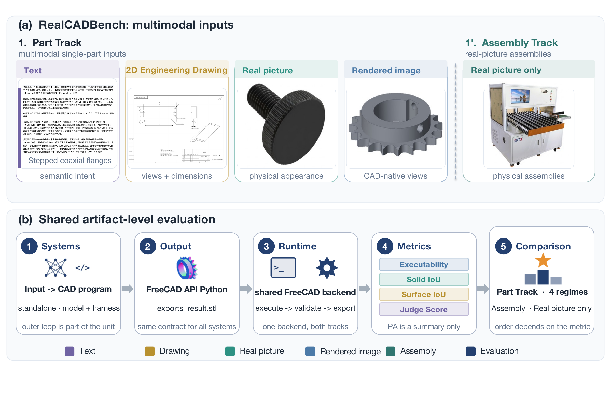

# RealCADBench

**RealCADBench: Benchmarking Parametric CAD Modeling from Industrial Design Intents**

[Paper (arXiv)](https://arxiv.org/abs/2609.03773) · [Dataset (Hugging Face)](https://huggingface.co/datasets/RealCADBench/RealCADBench-V1.0)

## Abstract

Parametric computer-aided design (CAD) modeling is difficult to evaluate with a single metric. Existing CAD benchmarks often emphasize synthetic or CAD-native settings, limited input modalities, or executability and IoUs alone. We introduce RealCADBench, a benchmark for intent-to-program CAD modeling from real industrial design intents. It contains 12,632 tasks from 19 factory-automation categories and spans text descriptions, 2D engineering drawings, real product pictures, and rendered images for both Part and Assembly modeling. We report results on a 1,770-task evaluation slice: 1,745 Part tasks across four input regimes and RCB-Assm25, a 25-task assembly study used in every reported assembly comparison. Each method generates FreeCAD API Python, which a shared runtime executes to export the 3D model. We evaluate the exported model using executability, Solid IoU, Surface IoU, and a rubric-based visual-semantic identity Judge. Among the nine standalone frontier large models evaluated, no model leads all four metrics. Across six frontier-scale large models, executability ranges from 0.565 to 0.812, Solid IoU from 0.2841 to 0.5379, and Surface IoU from 0.112 to 0.217 across the four Part regimes. The highest regime-balanced composite comes from a different model than the leaders on the four component metrics. On RCB-Assm25, Codex with GPT-5.5 improves executability and both IoU metrics over standalone GPT-5.5, but lowers the Judge score by 6.98 percentage points, leaving GPT-5.5 as the Judge leader. We also observe recurring failure modes, most notably missing fine structures, loss of part identity, and incorrect assembly placement. These results show that execution alone is insufficient to characterize realistic CAD modeling and that frontier models and agents differ substantially across executability, IoUs, and visual-semantic identity.

## Leaderboards

Results from Tables 4 and 5 of the [paper](https://arxiv.org/abs/2609.03773). Rows are ranked by PA in descending order within each track. Higher is better for all reported metrics. **Bold** marks the best values in the PA and Exec. columns, including ties.

### Part Track

Each component is macro-averaged across the four input regimes. Regime-balanced PA is the macro-average of the four regime-specific PAs. Solid IoU, Surface IoU, and Judge are conditional on evaluator-available artifacts and should be read together with executability (Exec.). See Appendix Tables 7–10 of the paper for regime-specific results.

| Model | Regime-balanced PA ↑ | Exec. ↑ | Solid IoU (cond.) ↑ | Surface IoU (cond.) ↑ | Judge (cond.) ↑ |
| :--- | ---: | ---: | ---: | ---: | ---: |
| Gemini 3.1 Pro Preview | **0.5507** | 0.8825 | 0.4291 | 0.1578 | 73.33 |
| GPT-5.5 | 0.5478 | **0.9311** | 0.3829 | 0.1393 | 73.79 |
| Claude Opus 4.8 | 0.5316 | 0.8922 | 0.4080 | 0.1433 | 68.31 |
| GPT-5.4 | 0.4814 | 0.8005 | 0.3795 | 0.1337 | 61.19 |
| Qwen3.8-27B | 0.4575 | 0.7961 | 0.3585 | 0.1126 | 56.30 |
| Kimi K3 | 0.4195 | 0.3422 | 0.4481 | 0.1657 | 72.23 |
| Doubao Seed 2.0 Pro | 0.3842 | 0.4315 | 0.3767 | 0.1328 | 59.57 |
| Qwen3-VL-32B | 0.2902 | 0.3322 | 0.2885 | 0.0995 | 44.07 |
| Qwen3-VL-8B | 0.2309 | 0.2100 | 0.2833 | 0.0885 | 34.19 |

### Assembly Track: RCB-Assm25

RCB-Assm25 is the 25-task stratified study used for all reported assembly comparisons. Executability uses all 25 tasks. Solid IoU, Surface IoU, and Judge are conditional on evaluator-available artifacts and should be read together with Exec. Judge is reported on a 0–100 scale. Entries with Codex or Claude Code evaluate the model together with its agent harness.

| Model / System | PA ↑ | Exec. ↑ | Solid IoU (cond.) ↑ | Surface IoU (cond.) ↑ | Judge (cond.) ↑ |
| :--- | ---: | ---: | ---: | ---: | ---: |
| Codex + GPT-5.5 | **0.5228** | **1.0000** | 0.2817 | 0.1161 | 69.35 |
| GPT-5.4 | 0.5028 | **1.0000** | 0.2366 | 0.1046 | 66.98 |
| GPT-5.5 | 0.4777 | 0.8400 | 0.2103 | 0.0971 | 76.33 |
| Gemini 3.1 Pro Preview | 0.4724 | 0.9200 | 0.2306 | 0.0979 | 64.10 |
| Claude Code + Claude Opus 4.8 | 0.4644 | 0.8800 | 0.2732 | 0.0864 | 61.80 |
| Claude Opus 4.8 | 0.4638 | 0.8800 | 0.2670 | 0.1058 | 60.24 |
| Kimi K3 | 0.4338 | 0.7200 | 0.2665 | 0.1039 | 64.48 |
| Doubao Seed 2.0 Pro | 0.3389 | 0.5200 | 0.1632 | 0.0969 | 57.56 |

## Continuous Evolution

RealCADBench will continue to evolve. We will update the dataset and refine its evaluation metrics based on community feedback, insights from newly released benchmarks and leaderboards, and lessons from real-world product development and deployment. Through this ongoing iteration, we aim to better reflect practical industrial CAD requirements and provide more meaningful assessments of AI CAD capabilities.
